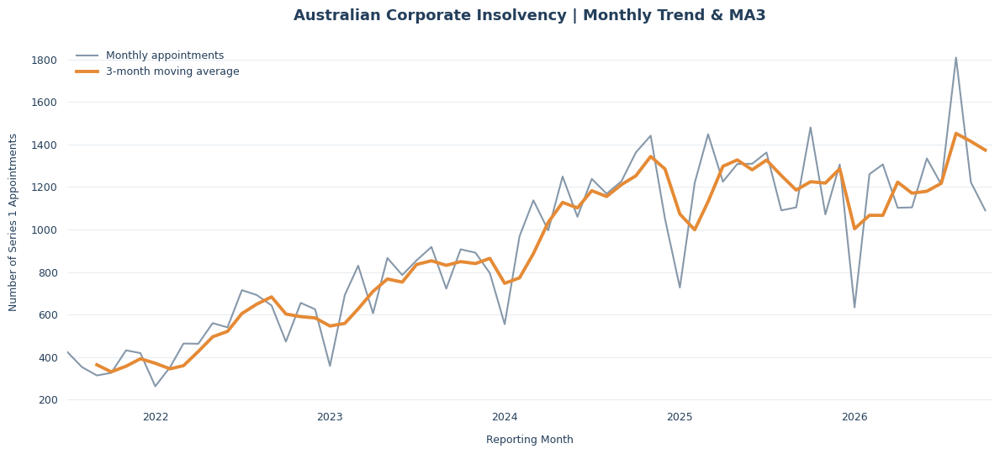
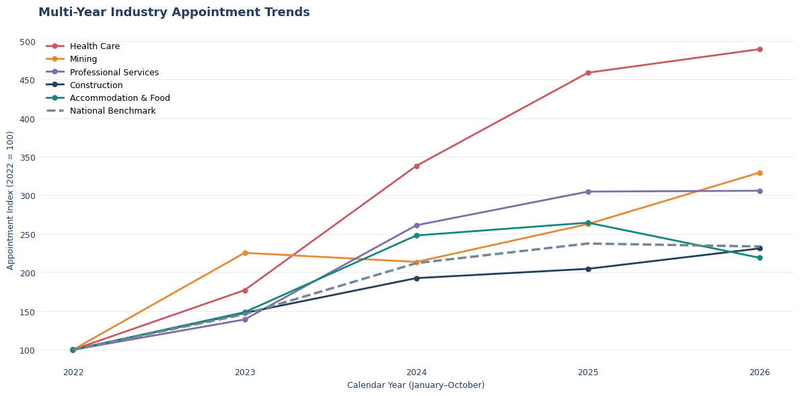
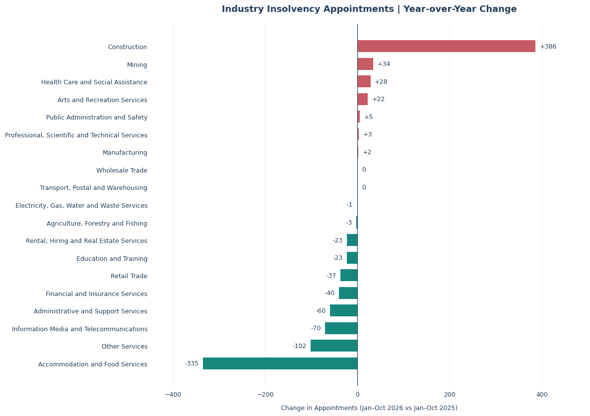
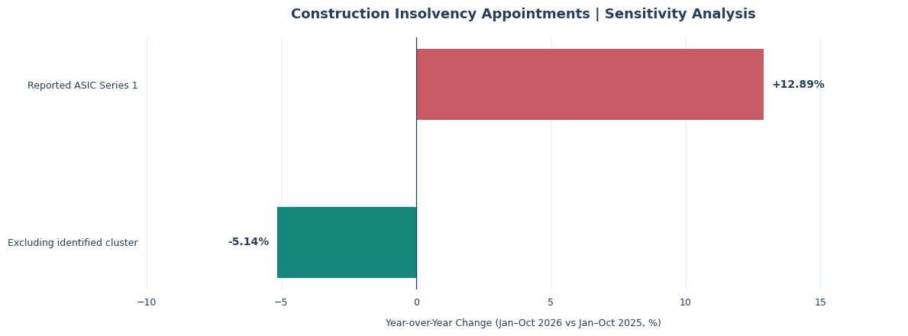
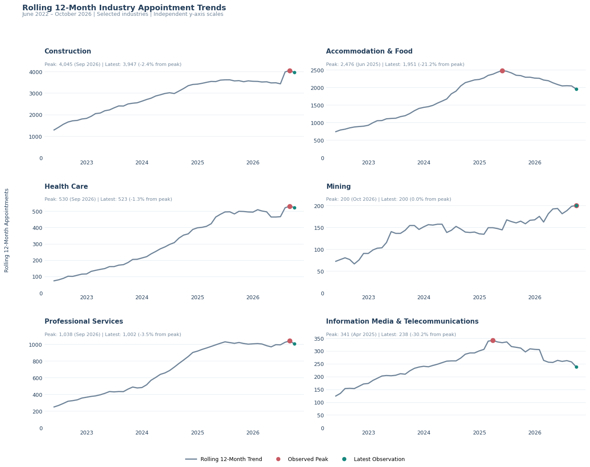

# Australian Corporate Insolvency Analysis

**End-to-End Financial Data Analytics Project | Python · Pandas · Databricks**

Industry Distress & Credit Risk Monitoring (2021-2026)

---

## Project Overview

This project examines Australian corporate insolvency activity, identifies industries exhibiting sustained or emerging financial distress signals, and investigates the influence of concentrated appointment activity on industry-level trends.

Using publicly available insolvency statistics from the Australian Securities and Investments Commission (ASIC), the analysis covers 58,115 appointment records across 64 reporting months from July 2021 to October 2026.

The project combines national trend analysis, historical industry diagnostics, recent distress indicators, event concentration investigation and sensitivity analysis to develop an integrated monitoring framework across 19 classified industries.

The focus is on industry-level distress monitoring and credit risk prioritisation, rather than company-level default prediction or credit loss estimation.

---

## Business Questions

1. How has Australian corporate insolvency activity evolved since July 2021, and what long-term, recent and seasonal patterns can be identified?
2. Which industries exhibit sustained historical growth, above-national appointment growth or expanding shares of national insolvency activity?
3. Which industries show elevated or persistent distress signals in recent reporting periods?
4. To what extent does concentrated appointment activity influence observed industry trends, particularly the Construction increase in August 2026?
5. Which industries should be prioritised for additional monitoring or investigation, and how does historical evidence influence these recommendations?

---

## Tools & Technologies

- **Python:** Data processing, time-series analysis, industry diagnostics and rule-based monitoring.
- **Pandas & NumPy:** Data transformation, historical comparisons, rolling calculations and analytical classification.
- **OpenPyXL:** Excel workbook extraction and official ASIC statistics reconciliation.
- **Databricks:** Notebook development, execution and analytical data management.
- **Matplotlib:** National trend analysis, industry comparisons and business-oriented visualizations.

---

## Data Sources

- **ASIC Insolvency Statistics - Series 1 and Series 2:** Australian corporate insolvency appointment records and published monthly summary statistics.
- **Publication date:** 17 November 2026.
- **Primary analytical dataset:** Series 1 appointment records.

Analytical coverage:

| Metric | Coverage |
|---|---:|
| Reporting period | July 2021 - October 2026 |
| Reporting months | 64 |
| Raw appointment records | 77,494 |
| Series 1 records before final preparation | 58,119 |
| Final analytical records | 58,115 |
| Recorded industry categories | 20 |
| Classified industries | 19 |

National appointment totals include all 20 recorded industry categories, including Unknown, while individual industry monitoring focuses on the 19 classified industries.

Monthly appointment counts are reconciled against the official ASIC summary statistics contained within the source workbook.

**Official data source:** Australian Securities and Investments Commission (ASIC)

---

## Key Findings

### National Corporate Insolvency Trends

| Reporting Period | Insolvency Appointments |
|---|---:|
| January-October 2022 | 5,166 |
| January-October 2023 | 7,541 |
| January-October 2024 | 10,960 |
| January-October 2025 | 12,272 |
| January-October 2026 | 12,073 |

National appointment activity increased by **133.70% between 2022 and 2026** across comparable January-October reporting periods.

Despite a year-over-year decline of 1.62% in 2026, appointment activity remains substantially above earlier observed levels.

Seasonal analysis also identifies relatively low appointment activity in January, reinforcing the importance of comparable reporting periods when interpreting monthly movements.

### Historical Industry Distress

All 19 classified industries recorded higher January-October appointment counts in 2026 than in 2022.

| Historical Indicator | Industries |
|---|---:|
| Above-national multi-year growth | 9 |
| Positive growth in every annual comparison | 4 |
| Rising rolling trends across both comparison horizons | 5 |
| Expanding share of national appointment activity | 12 |

Health Care and Social Assistance recorded multi-year appointment growth of **389.13%**, alongside a 2.13 percentage point increase in its national appointment share.

Professional, Scientific and Technical Services recorded growth of 205.86%, with its national appointment share increasing by 1.87 percentage points.

These historical movements reveal differences in industry trajectories that are not fully captured by recent year-over-year comparisons.

### Recent Industry Distress Signals

| Industry | Jan-Oct 2025 | Jan-Oct 2026 | YoY Growth |
|---|---:|---:|---:|
| Mining | 134 | 168 | +25.37% |
| Accommodation and Food Services | 1,952 | 1,617 | -17.16% |

Mining recorded positive year-over-year changes in eight of the ten comparable months, while its rolling 12-month appointment count reached an observed historical peak of 200 in October 2026.

In contrast, Accommodation and Food Services recorded a 21.20% decline in rolling 12-month appointments from its observed peak in June 2025.

These contrasting trajectories highlight the importance of considering appointment growth, monthly persistence and historical direction together.

### Construction Appointment Concentration

Construction recorded 3,380 appointments in January-October 2026, compared with 2,994 during the corresponding period in 2025.

Further investigation identified exceptional appointment activity in August 2026:

- 826 appointments, compared with 273 in August 2025.
- 565 voluntary administration appointments.
- 541 appointments recorded on 25 August 2026, involving 541 distinct ACNs.
- 540 appointments associated with the same recorded appointee on that date.

An illustrative sensitivity scenario excludes the identified 540 concentrated appointments from the 2026 comparison.

| Scenario | Jan-Oct 2026 Appointments | YoY Growth |
|---|---:|---:|
| Reported appointment activity | 3,380 | +12.89% |
| Illustrative sensitivity scenario | 2,840 | -5.14% |

The reversal in growth direction highlights the influence of concentrated appointment activity on aggregate industry trends.

The sensitivity scenario does not establish that the identified records are invalid and does not replace the official ASIC statistics. The primary analytical dataset remains unchanged.

### Integrated Industry Monitoring Priorities

The integrated framework combines recent appointment signals with historical growth, rolling trends and industry share movements.

| Monitoring Action | Industries | Count |
|---|---|---:|
| Targeted Investigation | Construction | 1 |
| Enhanced Monitoring | Mining; Health Care and Social Assistance; Arts and Recreation Services; Public Administration and Safety | 4 |
| Historical Trend Review | Professional, Scientific and Technical Services | 1 |
| Emerging Trend Watch | Manufacturing | 1 |
| Routine Monitoring | Remaining classified industries | 12 |
| **Total** | | **19** |

Incorporating historical evidence changes the recommended monitoring actions for three industries:

| Industry | Recent Action | Integrated Action |
|---|---|---|
| Health Care and Social Assistance | Emerging Trend Watch | Enhanced Monitoring |
| Public Administration and Safety | Emerging Trend Watch | Enhanced Monitoring |
| Professional, Scientific and Technical Services | Emerging Trend Watch | Historical Trend Review |

Historical evidence changes the monitoring recommendations for **3 of 19 classified industries (15.79%)**.

The framework supports differentiated monitoring actions based on observed appointment patterns. These actions are not calibrated credit risk ratings, and Routine Monitoring does not imply low credit risk.

---

## Methodology - End-to-End Analytical Workflow

### Phase 1 - Data Preparation & ASIC Reconciliation

- Extract appointment-level records from the ASIC source workbook.
- Inspect dataset structure, variables and reporting periods.
- Filter Series 1 records and restrict the analysis to completed reporting months.
- Assess missing values, exact duplicates and repeated company identifiers.
- Prepare monthly and industry-level analytical datasets.
- Reconcile monthly appointment counts against official ASIC summary statistics.

The final analytical dataset reconciles with official ASIC statistics across all 64 reporting months, with no unmatched months or appointment count differences.

### Phase 2 - National Corporate Insolvency Analysis

- Examine monthly appointment trends and three-month moving averages.
- Calculate monthly year-over-year appointment growth.
- Compare equivalent January-October reporting periods.
- Assess seasonal appointment patterns across completed financial years.
- Establish national benchmarks for industry-level comparisons.

### Phase 3 - Historical & Recent Industry Distress Analysis

- Examine multi-year industry appointment growth relative to national growth.
- Assess annual growth consistency and rolling 12-month trends.
- Evaluate historical industry share evolution.
- Calculate recent year-over-year appointment changes and historical deviations.
- Assess recent industry share shifts and monthly growth persistence.
- Develop a recent industry monitoring priority matrix.

### Phase 4 - Event Concentration & Sensitivity Analysis

- Identify monthly contributions to Construction appointment growth.
- Investigate appointment type and effective date concentration.
- Assess distinct company identifiers and recorded appointee concentration.
- Evaluate an illustrative sensitivity scenario excluding the identified appointment cluster.
- Compare reported and sensitivity-based industry growth without modifying the primary dataset.

### Phase 5 - Integrated Monitoring & Business Recommendations

- Combine recent monitoring signals with four historical indicators: above-national growth, consistent annual growth, rising rolling trends and expanding industry share.
- Apply documented decision rules to assign monitoring actions.
- Compare recent and integrated monitoring recommendations.
- Develop differentiated industry monitoring priorities and business recommendations.
- Establish monthly monitoring, event-driven investigation and periodic review recommendations.
- Validate industry metrics, historical indicators, monitoring decision rules and final analytical outputs.

The final framework provides a basis for allocating industry monitoring resources alongside borrower-level financial assessments and portfolio-specific credit risk information.

---

## Project Structure

```text
australian-corporate-insolvency-analysis/
├── README.md
├── .gitignore
├── Australian_Corporate_Insolvency_Analysis.ipynb
├── images/
│   ├── 01_national_insolvency_trends.png
│   ├── 02_historical_industry_trends.png
│   ├── 03_recent_monitoring_signals.png
│   ├── 04_construction_sensitivity.png
│   └── 05_rolling_industry_trends.png
└── reports/
    └── Australian_Corporate_Insolvency_Analysis_Python.pdf
```

The notebook contains the full analytical workflow, saved execution results, validation checks and visualizations.

---

## Python Visualization Preview

The following visualizations summarise the principal findings from the completed Python analysis.

### 1. National Corporate Insolvency Trends

Illustrates national appointment movements and the historical context of recent insolvency activity.



### 2. Historical Industry Distress Trends

Highlights differences in historical appointment trajectories across industries.



### 3. Recent Industry Monitoring Signals

Compares recent industry-level appointment changes and monitoring signals.



### 4. Construction Sensitivity Analysis

Compares reported Construction appointment growth with the illustrative sensitivity scenario excluding 540 concentrated appointments.



### 5. Rolling 12-Month Industry Appointment Trends

Illustrates longer-term industry appointment trajectories using rolling 12-month totals, providing historical context for interpreting recent distress signals.



---

## Project Status - Completed

- [x] ASIC data extraction and preparation
- [x] Data quality assessment and official ASIC reconciliation
- [x] National insolvency trend and seasonality analysis
- [x] Historical industry growth and rolling trend analysis
- [x] Recent industry distress and monitoring indicators
- [x] Construction appointment concentration investigation
- [x] Illustrative sensitivity analysis
- [x] Integrated industry monitoring framework
- [x] Business recommendations and final analytical validation

---

## Limitations

- Appointment counts do not measure industry insolvency rates or company-level default probabilities.
- Repeated company identifiers mean appointment records do not necessarily represent unique companies across the entire analytical period.
- The dataset does not contain outstanding credit exposures, recovery amounts or realised credit losses.
- Historical growth and industry share movements depend on the selected reference periods and initial appointment volumes.
- Rolling periods contain overlapping observations and may delay the identification of emerging turning points.
- Concentrated appointment activity can influence aggregate industry trends. The Construction sensitivity scenario is illustrative rather than an official statistical adjustment.
- Historical monitoring indicators may capture related aspects of the same underlying appointment trends and should not be treated as independent risk factors.
- Monitoring thresholds are project-defined analytical rules and have not been calibrated against observed defaults or credit losses.
- The results reflect the specified ASIC publication and may differ from analyses using subsequently revised data.

---

## Reports & Documentation

Detailed analytical materials are available below:

- [Python Analysis Report](reports/Australian_Corporate_Insolvency_Analysis_Python.pdf)
- [Complete Python Analysis Notebook](Australian_Corporate_Insolvency_Analysis.ipynb)

The PDF report provides the complete analytical methodology, supporting calculations, validation results, visualizations and business interpretations.

The Jupyter notebook contains the underlying Python code and saved execution outputs.

For a concise review of the monitoring framework and business implications, see **Section 4.13 - Integrated Industry Monitoring Framework** and **Section 5 - Business Recommendations & Credit Risk Implications**.

---

## Execution Environment & Reproducibility

The project was developed and executed using Python in Databricks.

| Component | Version |
|---|---|
| Python | 3.12.3 |
| Pandas | 2.3.3 |
| NumPy | 2.3.4 |
| Matplotlib | 3.10.6 |
| OpenPyXL | 3.1.5 |

### Data Requirements

- ASIC Insolvency Statistics - Series 1 and Series 2 workbook released on 17 November 2026.
- A compatible Databricks environment with the required Python libraries.
- An accessible data storage location for the source workbook.

Source workbook:

`asic-insolvency-statistics-series-1-and-series-2-published-17-november-2026.xlsx`

Worksheets used:

| Worksheet | Application |
|---|---|
| Data set | Appointment-level source records |
| 1 | Official Series 1 monthly reconciliation |

### Execution Workflow

1. Obtain the specified ASIC source workbook.
2. Configure the Databricks environment and source file path in Section 2.1.
3. Execute the notebook sequentially to prepare and reconcile the appointment data.
4. Run national trend analysis, industry distress diagnostics and sensitivity analysis.
5. Execute the integrated monitoring framework and review the business recommendations.
6. Confirm that the final data integrity and analytical validation checks pass.

### Reproducibility Notes

- The notebook uses a Databricks Unity Catalog Volume for source data storage.
- The original ASIC workbook is not included in this repository.
- Reproducing the exact published figures requires the corresponding ASIC data release and a compatible execution environment.
- Subsequent ASIC publications may contain additional observations or revised historical records.
- The OpenPyXL conditional formatting warning relates to Excel formatting rather than the worksheet values used in the analysis.
- The saved notebook outputs document the completed analytical run.

---

## Author

**Minh Khanh Trinh**

Aspiring Data Analyst | Python · Financial Analytics · Data Engineering

[GitHub Profile](https://github.com/minhkhanh-trinh3196)

---

## Copyright Notice

© 2026 Minh Khanh Trinh. All rights reserved.

Original project code, analytical documentation, and visualizations are presented for portfolio demonstration purposes.

Third-party data and materials remain subject to their respective ownership, licensing, and usage terms.
